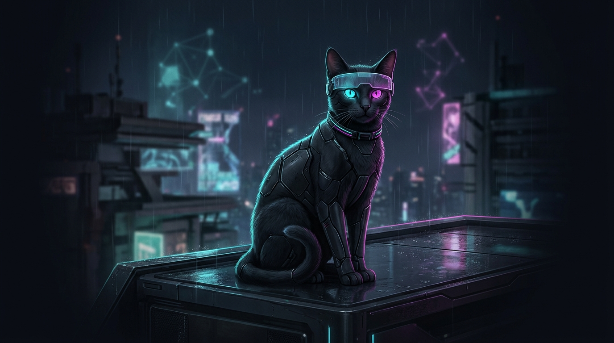

<div align="center">



<br/>

<a href="https://git.io/typing-svg">
  
</a>

<p>
  
  
  
</p>

</div>

---

```text
  /\_/\     [ SYSTEM_LOG // arion263 ]
 ( o.o )    > "Most of the real work happens off-grid."
  > ^ <     > Freelance developer & consultant · Based in Cuba 🇨🇺
            > Rule #0: Keep it sharp, keep it useful. And always pet the cat.
```

## 🕶️ Shadow Nodes — *The work you don't see on the grid*

> Not everything lives in public repositories. A big part of my work runs in private client environments, internal tools, and production deployments.

<table>
  <tr>
    <td width="50%" valign="top">
      <h3>⚡ Client & Freelance Systems</h3>
      <ul>
        <li><b>Custom Web Apps & Dashboards:</b> End-to-end interfaces and admin panels built with <code>Vue.js</code>, <code>TypeScript</code>, and <code>Django</code>.</li>
        <li><b>Backend & APIs:</b> RESTful services, auth flows, and database-backed platforms tailored to real business needs.</li>
      </ul>
    </td>
    <td width="50%" valign="top">
      <h3>🛰️ Infra, Cloud & Automation</h3>
      <ul>
        <li><b>Containerized Deploys:</b> Production setups using <code>Docker</code>, <code>Railway</code>, <code>Firebase</code>, and <code>Waitress</code>.</li>
        <li><b>Ops & Scripting:</b> Internal automation, testing harnesses, and system utilities in <code>Python</code>, <code>Shell</code>, and <code>PowerShell</code>.</li>
      </ul>
    </td>
  </tr>
</table>

---

## 📡 Public Nodes — *Selected Case Studies*

<table>
  <tr>
    <td width="30%"><b><a href="https://github.com/Arion263/LADETEC-TESTING-">LADETEC-TESTING-</a></b></td>
    <td>Testing & frontend experimentation node.<br/><sub><code>Vue</code> · <code>Frontend</code></sub></td>
  </tr>
  <tr>
    <td width="30%"><b><a href="https://github.com/Arion263/ScriptsMalignos">ScriptsMalignos</a></b></td>
    <td>Mis scripts malignos — shell utilities & automation experiments.<br/><sub><code>Shell</code> · <code>Automation</code></sub></td>
  </tr>
  <tr>
    <td width="30%"><b><a href="https://github.com/Arion263/Arion263">Arion263</a></b></td>
    <td>Profile hub & full-stack sandbox (Django, Docker, Firebase, Railway).<br/><sub><code>Python</code> · <code>JavaScript</code> · <code>Infra</code></sub></td>
  </tr>
</table>

---

## 🧰 Cyberdeck — *Tools & Stack*

<div align="center">


</div>

---

## 📊 Telemetry & Highlights

<p align="center">
  
</p>

---

<div align="center">

```text
      |\__/,|   (`\
    _.|o o  |_   ) )
  -(((---(((--------
  // arion263 · signal active · meow.exe
```

<sub><a href="https://github.com/arion263">GitHub</a> · Built in the neon dark</sub>

</div>
